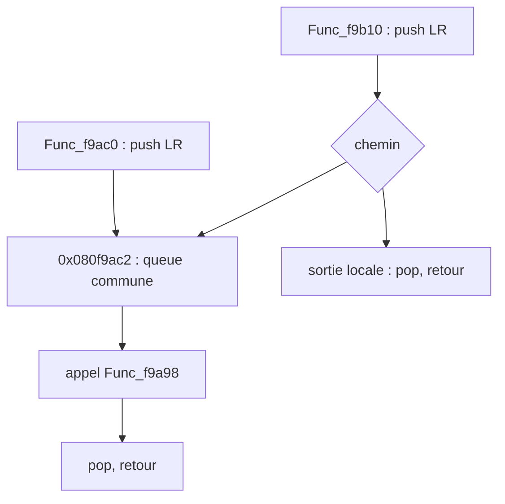

# Étape 11 : représentation de la queue partagée

## Résultat retenu

Le projet de travail est `archive:ghidra_shared_split/step9.gpr`, programme `gs_us_map.elf`. L'outil intégré `CreateFunctionCmd` crée Func_f9ac0 et réattribue la queue commune à son corps.

- 2 141 fonctions, contre 2 140 après l'étape 9.
- Les 227 entrées candidates sont maintenant toutes des fonctions.
- 1 771/2 253 entrées du dépôt reconnues, rappel 78,61 %.
- Une seule adresse ajoutée : 0x080f9ac0. Aucune entrée précédente perdue.
- Deux fonctions décompilées après l'essai sans avertissement : Func_f9ac0 et Func_f9b10.
- Le C de Func_f9b10 avant/après séparation est identique octet pour octet (793 octets).
- Tous les octets, instructions et destinations de flot des deux plages examinées sont inchangés.
- Sauvegarde et réouverture vérifiées : mêmes entrées, corps, annotations et instructions.

Le script de récupération initial refusait les chevauchements avant d'appeler directement FunctionManager.createFunction. La commande intégrée sait réattribuer les corps existants. Ce refus était une précaution du script, pas une impossibilité de reconnaître les deux entrées.

## Ce que le code partage

Référence : `work/repo/rom_f9000/src/rom_f95e0.s:576` et `:626`.

- Func_f9ac0 commence à 0x080f9ac0 par `push {lr}`, puis tombe dans la queue à 0x080f9ac2.
- Func_f9b10 empile aussi LR à son entrée. Les branches 0x080f9b1e et 0x080f9b30 vont directement à 0x080f9ac2, en sautant le push de Func_f9ac0.
- La queue appelle Func_f9a98 à 0x080f9ad4, puis dépile LR et revient.
- L'autre sortie de Func_f9b10 possède son propre dépilage et retour.
- À l'entrée de la queue, le LR de l'appelant est donc déjà sur la pile, quel que soit le chemin.

Les opcodes ROM confirment `push {lr}` (0xb500) aux deux entrées et les deux branches Thumb (0xe7d0 et 0xe7c7) vers 0x080f9ac2. Preuve : `work/shared_tail_branch_check.json`.



## Deux représentations testées

| Variante | Fonctions | Propriétaire de la queue | Résultat |
|---|---:|---|---|
| Label d'entrée sans nouvelle fonction | 2 140 | Func_f9b10 | Corps et chemins conservés ; entrée f9ac0 seulement étiquetée |
| CreateFunctionCmd + annotations, retenue | 2 141 | Func_f9ac0 | Deux entrées reconnues ; C de f9b10 identique |

Ghidra refuse les corps qui se chevauchent via FunctionManager.createFunction ; une fonction peut cependant contenir plusieurs plages disjointes. CreateFunctionCmd résout le chevauchement en transférant les octets de la queue :
- Avant : Func_f9b10 possède [0x080f9ac2, 0x080f9adf] et [0x080f9b10, 0x080f9b3d].
- Après : Func_f9ac0 possède [0x080f9ac0, 0x080f9adf] ; Func_f9b10 possède [0x080f9b10, 0x080f9b3d].
- Les deux branches vers la queue restent présentes. Le décompilateur suit ces branches vers l'intérieur de l'autre corps et restitue le même C dans cet essai.

Source API : Ghidra 12.1.4, `Ghidra/Framework/SoftwareModeling/lib/SoftwareModeling-src.zip!ghidra/program/model/listing/FunctionManager.java:72` (création et chevauchement). Source commande : `Ghidra/Features/Base/lib/Base-src.zip!ghidra/app/cmd/function/CreateFunctionCmd.java:389` (résolution des chevauchements).

Annotations conservées : Func_f9ac0 à son entrée, Func_f9b10 à la sienne, label `shared_tail_f9ac2` et commentaire « LR déjà empilé par l'une des deux entrées ».

## Limite concrète du graphe d'appels

La possession du bloc change l'attribution des appels de Ghidra :
- Avant : getCalledFunctions(Func_f9b10) rapporte Func_f9a98 et Func_f9ab4.
- Après : getCalledFunctions(Func_f9b10) ne rapporte plus que Func_f9ab4.
- Après : getCalledFunctions(Func_f9ac0) rapporte Func_f9a98.

Func_f9b10 atteint toujours l'appel à Func_f9a98 par la queue, et son C contient toujours cet appel. Un graphe d'appels fondé seulement sur les corps attribués manque donc ce chemin. Il faut conserver les branches vers les blocs internes pour analyser les appels exécutables depuis chaque entrée. Une décompilation terminée n'établit toujours pas des types ou signatures corrects.

## Preuves et reproduction

Script durable : `scripts/SharedTailProbe.java`, modes inspect, split, annotate. Chaque mode exporte les entrées, les corps, les octets et flots locaux, les annotations et le statut des décompilations.

```sh
# Sur une copie du projet sauvegardé après l'étape 9 :
~/ghidra/ghidra_12.1.4_PUBLIC/support/analyzeHeadless ~/rea-golden-sun/archive:ghidra_shared_split step9 -process gs_us_map.elf -noanalysis -scriptPath ~/rea-golden-sun/scripts -postScript SharedTailProbe.java split ~/rea-golden-sun/work/shared_split
~/ghidra/ghidra_12.1.4_PUBLIC/support/analyzeHeadless ~/rea-golden-sun/archive:ghidra_shared_split step9 -process gs_us_map.elf -noanalysis -scriptPath ~/rea-golden-sun/scripts -postScript SharedTailProbe.java annotate ~/rea-golden-sun/work/shared_selected
# Réouverture sans modification :
~/ghidra/ghidra_12.1.4_PUBLIC/support/analyzeHeadless ~/rea-golden-sun/archive:ghidra_shared_split step9 -process gs_us_map.elf -noanalysis -readOnly -scriptPath ~/rea-golden-sun/scripts -postScript SharedTailProbe.java inspect ~/rea-golden-sun/work/shared_verified
```

- Comparaison sans annotations : `work/shared_split/`.
- Variante label seule : `work/shared_annotated/`, projet `archive:ghidra_shared_annotated/`.
- État retenu annoté : `work/shared_selected/`.
- Réouverture : `work/shared_verified/`.
- Vérification synthétique : `work/shared_selected/verification.json`.
- Baseline et appels avant transfert : `work/shared_baseline_inspect/`.

## Prochaine étape

Examiner les 482 entrées du dépôt encore absentes : 449 Thumb et 33 ARM. Distinguer les instructions déjà décodées sans fonction, les blocs non décodés et les problèmes de frontière ou d'adresse, avant une nouvelle récupération guidée. La session REA reste sur sa baseline ; les modifications sont dans le projet Ghidra séparé.
